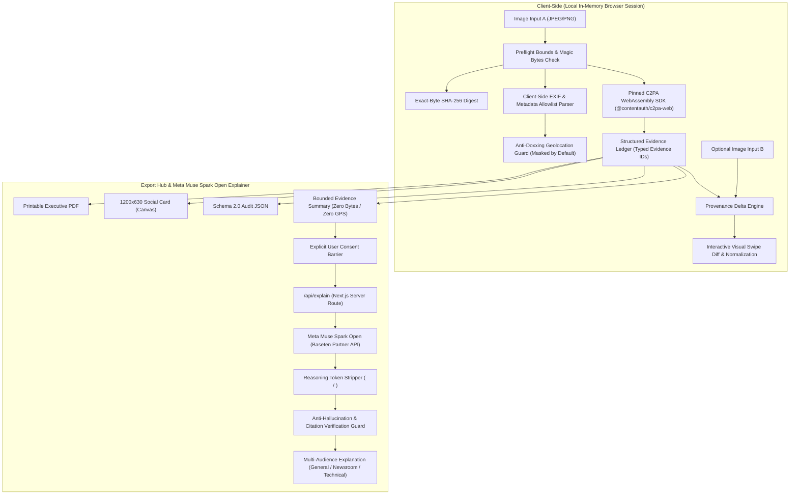

# OriginLens

> **Evidence-First Media Provenance Explorer & Meta Muse Spark Open Explainer**  
> Inspect supported image provenance evidence and compare two independent files without guessing origin, chronology, authorship, or scene truth. Powered by client-side WebAssembly C2PA and Meta Muse Spark Open reasoning via official hackathon partner Baseten.

[](https://inference.baseten.co)
[](https://contentauthenticity.org)
[](https://www.typescriptlang.org/)
[](https://vitest.dev/)
[](https://playwright.dev/)
[](https://www.w3.org/WAI/standards-guidelines/wcag/)
[](https://docs.npmjs.com/cli/v10/commands/npm-audit)
[](LICENSE)

---

## Executive Overview

In the era of generative AI and synthetic media, traditional "AI detectors" rely on brittle, probabilistic black boxes. When an image lacks metadata, they mislabel it as "100% human-made"; when a single pixel differs, they generate false accusations of fraud.

**OriginLens** replaces opaque guesswork with **cryptographic provenance, verifiable evidence ledgers, and audited Meta Muse Spark Open intelligence**:

1. **Evidence Ledger:** Every finding traces directly to a real check, evidence ID, and validation standard.
2. **Provenance Delta:** Compare two images side-by-side with interactive swipe sliders and normalized pixel heatmaps without presuming an "original" or inferring intent.
3. **Meta Muse Spark Open Explainer (Baseten Partner):** Translates complex cryptographic manifests and EXIF clues into clear natural language across 3 distinct personas (General Public, Newsroom Editorial, Technical Specialists) with strict anti-hallucination citation verification and reasoning token parsing.
4. **Local-First Privacy:** Intake, SHA-256 fingerprinting, EXIF extraction, and C2PA reading run in the browser's volatile memory. Original image bytes are never uploaded.
5. **Anti-Doxxing Geolocation Guard:** Camera GPS coordinates are masked by default, supporting on-demand in-memory unmasking and safe outbound mapping.
6. **Multi-Format Export Hub:** Instant generation of Printable/Save-as-PDF Executive Reports with watermarks, 1200×630 Canvas Social Preview Cards, and Schema 2.0 JSON audit files.

---

## Core Architecture



---

## Key Features

### 1. 🔍 Single-File Evidence Ledger
* **C2PA Content Credentials:** Evaluates JUMBF manifest presence, manifest integrity, claim signature validity, and asset binding independently via official WebAssembly runtime.
* **Camera & Metadata Clues:** Extracts camera make, model, software, capture timestamp, and orientation while treating them honestly as unverified textual clues.
* **Anti-Doxxing Geolocation Guard:** Detects GPS metadata without leaking coordinates. Supports on-demand client-side unmasking with precision toggling (Precise vs. Coarse ~10 km region) and safe outbound links to OpenStreetMap and Google Maps.
* **Categorized Tabbed Dashboard:** 6 full-width responsive tabs (`Executive Overview`, `C2PA Credentials`, `Camera & EXIF`, `AI Clues & Co-Pilot`, `Technical Audit`, `Complete View`).

### 2. ⚖️ Provenance Delta (Comparison Engine)
* **Dual-File Independent Analysis:** Analyzes File A and File B in isolated pipelines without assuming chronology or authorship.
* **Interactive Visual Swipe Slider:** Real-time split-screen comparison allowing judges and users to swipe between two files.
* **Normalized Pixel Difference Metric:** Computes peak channel variance and differing pixel percentages with documented aspect ratio and orientation guards.
* **User Assertions:** Allows user labeling (e.g. "original" vs "edited") while explicitly marking them as user assertions—never endorsed as system fact.

### 3. 🤖 Meta Muse Spark Open Explainer (Baseten Partner)
* **Multi-Audience Personas:**
  * **General Public (ELI5):** Jargon-free explanations for everyday media consumers.
  * **Newsroom Editorial:** Focuses on source verifiability, chain-of-custody, and corroboration.
  * **Technical:** Focuses on exact hash bindings, JUMBF assertion trees, and trust policies.
* **Anti-Hallucination Citation Verification:** Server-side engine verifies that every single claim made by the model cites an actual evidence ID (`ev_...`) present in the report.
* **Reasoning Token Stripping:** Gracefully parses Muse Spark Open `<thought>` / reasoning tokens so clean JSON is validated against strict schemas.
* **Hedging-Aware Claims Filter (ADR-017):** Prohibits affirmative verdicts (authenticity, tampering, 100% guarantees) while permitting defensive educational negations in `whatRemainsUnknown`.
* **Zero-Leakage Bounded Data:** Only bounded check status codes, hashes, and evidence IDs are sent. Image bytes, precise GPS coordinates, and raw metadata are excluded.
* **Deterministic Fallback:** Seamlessly serves a deterministic rule-based template if the API is offline or unconfigured, ensuring zero broken screens.

### 4. 📄 Multi-Format Export Hub
* **Executive PDF Report:** Dedicated `@media print` layout unrolling all tabs, complete with watermark headers and legal disclaimers.
* **Visual Social Card (1200×630):** High-resolution Canvas generator displaying cryptographic fingerprints, C2PA badges, and compliance summaries for instant social sharing.
* **PRD v2.0 Audit JSON:** Machine-readable report with `includedOriginalImage: false` and `includedPreciseGps: false` guarantees.

---

## Quality Gates & Verification Evidence

OriginLens adheres to the highest level of software engineering discipline:

| Quality Gate | Standard | Status | Evidence |
|---|---|---|---|
| **Unit & Integration** | Vitest | **PASS (303 / 303)** | `npm test` |
| **End-to-End Suite** | Playwright (Chromium) | **PASS (49 / 49)** | `npx playwright test` |
| **Accessibility** | WCAG 2.1 AA (axe-core) | **PASS (0 Violations)** | `tests/e2e/accessibility.spec.ts` |
| **Type Safety** | TypeScript Strict | **PASS (0 Errors)** | `npm run typecheck` |
| **Linting** | ESLint Strict | **PASS (0 Errors / 0 Warnings)** | `npm run lint` |
| **Security Audit** | npm audit | **PASS (0 Vulnerabilities)** | `npm run audit` |
| **Production Build** | Next.js Turbopack | **PASS (100% Compiled)** | `npm run build` |

---

## Getting Started

### Prerequisites
* Node.js 18.18+ or 20+
* npm 9+

### Quick Setup

```bash
# 1. Clone repository
git clone https://github.com/Nightmare-026/OriginLens.git
cd OriginLens

# 2. Install dependencies
npm install

# 3. Configure optional Meta Muse Spark Open via Baseten (optional; deterministic fallback active by default)
cp .env.example .env.local
# Set MODEL_EXPLANATION_ENABLED=true and your MODEL_API_KEY if testing live Meta Model API

# 4. Run development server
npm run dev
```

Open [http://localhost:3000](http://localhost:3000) in your browser.

---

## Verification Commands for Judges

Judges can execute all verification suites with single commands:

```bash
# Run all unit tests
npm test

# Run all Playwright E2E browser tests
npm run test:e2e

# Run the 3-minute judging demo rehearsal
npx playwright test tests/e2e/demo-rehearsal.spec.ts

# Run production build
npm run build
```

---

## Documentation & Project History

* [`DEMO.md`](DEMO.md) — 3-minute rehearsed judging walkthrough with bundled fixtures.
* [`docs/implementation/verification-log.md`](docs/implementation/verification-log.md) — Detailed verification records across all phases.
* [`docs/implementation/decisions.md`](docs/implementation/decisions.md) — Architectural Decision Records (ADR-001 through ADR-017).
* [`docs/implementation/requirements-traceability.md`](docs/implementation/requirements-traceability.md) — V01–V50 PRD acceptance matrix.

---

## License

This project is licensed under the [MIT License](LICENSE).
