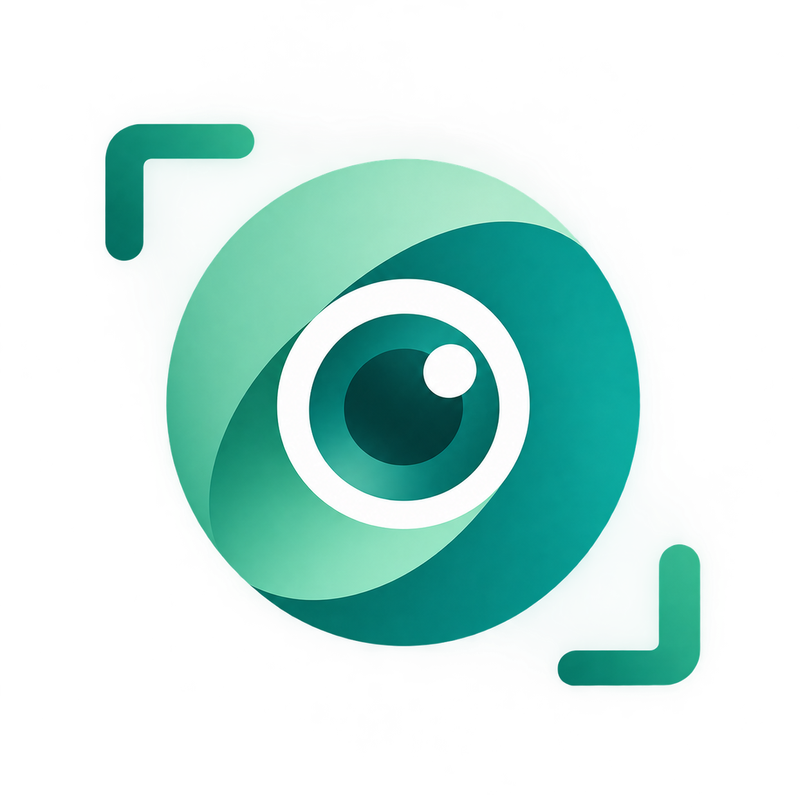
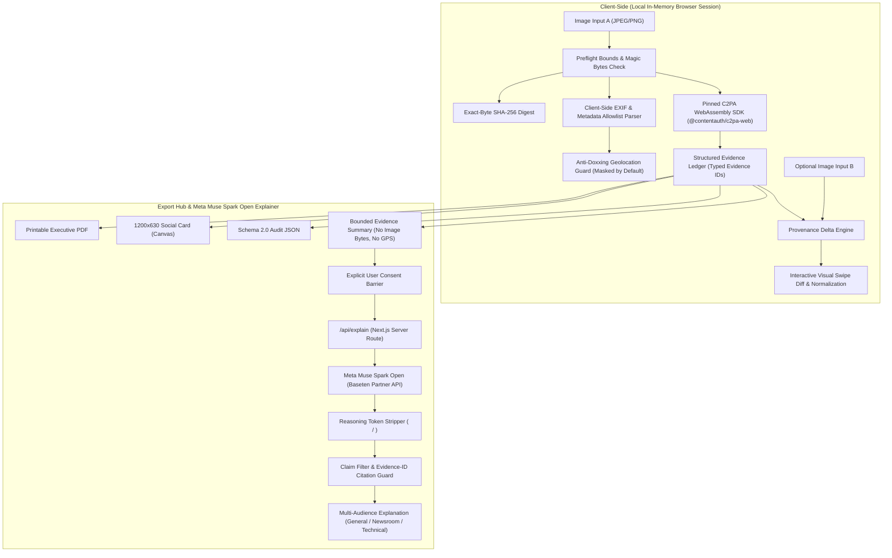

# OriginLens

> **Evidence-First Media Provenance & Comparison Studio**  
> Inspect supported image provenance evidence and compare two independent files without guessing origin, chronology, authorship, or scene truth. Powered by client-side WebAssembly C2PA and Meta Muse Spark Open reasoning via Baseten inference.

[](https://cerebralvalley.ai/e/meta-ai-developer-hackathon)
[](https://inference.baseten.co)
[](https://contentauthenticity.org)
[](https://originlens-ai.vercel.app/)
[](https://vitest.dev/)
[](https://playwright.dev/)
[](https://www.w3.org/WAI/standards-guidelines/wcag/)
[](docs/audit/FINAL_SECURITY_REPORT.md)
[](LICENSE)

---

## Quick Navigation

* 🌐 **Live Web Application:** [https://originlens-ai.vercel.app/](https://originlens-ai.vercel.app/)
* 📦 **GitHub Repository:** [https://github.com/Nightmare-026/OriginLens](https://github.com/Nightmare-026/OriginLens)
* 🎬 **Judging Demo Walkthrough:** [`DEMO.md`](DEMO.md)
* 📜 **Audited Product Specification v2.0:** [`OriginLens_PRD.md`](OriginLens_PRD.md)
* 📋 **Comprehensive Audit Report (G1–G18):** [`docs/audit/FINAL_AUDIT_REPORT.md`](docs/audit/FINAL_AUDIT_REPORT.md)
* 🏆 **Hackathon Compliance Review:** [`docs/audit/FINAL_HACKATHON_COMPLIANCE.md`](docs/audit/FINAL_HACKATHON_COMPLIANCE.md)

---

## 1. Visual Hero Preview



*Figure 1: OriginLens Dual-Mode Studio interface showing the Single-File Evidence Ledger with 6 categorized analysis tabs, cryptographic C2PA manifest verification, camera EXIF clues, anti-doxxing geolocation privacy guard, and grounded Meta Muse Spark Open intelligence.*

---

## 2. Executive Summary & System Philosophy

In the modern digital landscape, the exponential rise of generative AI and synthetic media has triggered an urgent demand for media authentication. Unfortunately, conventional "AI detectors" rely on brittle, probabilistic black boxes:
* When an uncredentialed image lacks metadata, detectors frequently mislabel it as *"100% human-made"*.
* When minor image compression or filtering alters high-frequency pixel patterns, detectors falsely accuse the creator of forgery.

**OriginLens** replaces probabilistic guesswork with **cryptographic provenance, verifiable evidence ledgers, and evidence-grounded Meta Muse Spark Open intelligence**:

```
                TRADITIONAL "AI DETECTORS"               ORIGINLENS EVIDENCE LEDGER
                ──────────────────────────               ──────────────────────────
 Approach       Probabilistic pixel heuristics           Cryptographic C2PA manifests + SHA-256
 Output         "87% probability of AI"                  Explicit checklist of verifiable facts
 Missing Data   Assumed "human-made"                     Honest limitation: "No credentials found"
 Uncertainty    Concealed behind a percentage            Explicit distinction: validity vs. trust
 Privacy        Images uploaded to remote servers        100% client-side in volatile browser RAM
 AI Role        Opaque classifier making verdicts         Grounded educator explaining verifiable facts
```

### What OriginLens IS:
* An **Evidence-First Media Provenance Explorer & Comparator** designed for researchers, newsroom editors, and everyday digital citizens.
* A client-side verification engine that validates Coalition for Content Provenance and Authenticity (C2PA) manifests using official WebAssembly.
* A dual-image Provenance Delta studio that compares two independent files with interactive swipe sliders and normalized pixel difference metrics without guessing chronology or authorship.
* An educational translator that harnesses Meta's open-weight reasoning model (**Muse Spark Open**) to translate dense cryptographic trees into accessible insights across 3 audience personas.

### What OriginLens IS NOT:
* **NOT** a universal AI detector.
* **NOT** a truth detector or forensic certification authority.
* **NOT** a real/fake binary classifier.
* **NOT** a creator-identification or legal ownership attribution service.

### Six Core Architectural Pillars:
1. **Evidence Ledger:** Every finding traces directly to a specific check, stable evidence ID (`ev_...`), and published validation standard.
2. **Provenance Delta:** Side-by-side comparison with interactive visual swipe sliders and normalized pixel difference heatmaps—without presuming an "original" or inferring intent.
3. **Meta Muse Spark Open Explainer:** Translates complex cryptographic manifests and camera metadata into clear natural language across 3 personas (General Public, Newsroom Editorial, Technical Specialists) with strict citation verification and chain-of-thought token parsing.
4. **Local-First Privacy:** Intake, SHA-256 hashing, EXIF parsing, and C2PA reading run entirely in the browser's volatile memory. Original image bytes are never uploaded to any server.
5. **Anti-Doxxing Geolocation Guard:** Camera GPS coordinates are masked by default (`••••••••••••`), supporting on-demand in-memory unmasking, coarse regional rounding (~10 km safe radius), and safe outbound mapping.
6. **Multi-Format Export Hub:** Instant generation of Printable/Save-as-PDF Executive Reports with watermarks, 1200×630 Canvas Social Preview Cards, and Schema 2.0 JSON audit files.

---

## 3. Meta Global AI Developer Hackathon 2026 Alignment

OriginLens was specifically engineered for the **Meta Global AI Developer Hackathon 2026**, co-hosted by Meta and Cerebral Valley:

* **Track:** **Indie Developer Track** (Individual builder / student creator).
* **Core Theme:** **AI for Media Literacy & Information Integrity**.
* **Selected Model:** **Meta Muse Spark Open** (`meta-models/muse-spark-open-1026`), Meta's advanced open-weight reasoning model.
* **Inference Partner:** Hosted on **Baseten** (`https://inference.baseten.co/v1`), Meta's official hosted inference partner for the hackathon.
* **Attribution Notice:** Prominently displays mandatory *"Built with Muse Spark Open"* attribution on the About page (`/about`) and in export disclosures per Muse Model License §3.
* **Truthful Representation:** Accurately disclosed as hosted open-weight Meta models on Baseten partner inference, rather than the proprietary Meta Model API (`api.meta.ai`).

### Official Judging Criteria Alignment Matrix

| Judging Criterion | Weight | How OriginLens Excels | Competitive Advantage |
|---|---|---|---|
| **Technical Execution & Depth** | 30% | Client-side WebAssembly C2PA SDK (`@contentauth/c2pa-web@0.15.4`), exact-byte SHA-256 digests, mathematical pixel delta normalization, strict Zod runtime schemas, 326 unit tests, 54 browser E2E tests, and 0 axe accessibility violations. | Most provenance apps rely on server mocks or basic API wrappers; OriginLens executes true cryptographic JUMBF manifest validation entirely in-browser. |
| **Theme Alignment & Impact** | 25% | Directly champions "AI for Media Literacy & Information Integrity" by replacing brittle black-box detectors with transparent evidence ledgers, honest uncertainty, and educational multi-persona explanations. | Avoids the fatal trap of claiming "AI detection"; empowers users to critically evaluate verifiable provenance evidence. |
| **AI Integration Quality** | 20% | Evidence-grounded system prompting, strict citation whitelisting, chain-of-thought reasoning token stripping, banned claim filtering, and graceful deterministic degradation across 3 distinct personas. | AI does not invent verdicts; it translates complex cryptographic manifests into plain-language educational insights with zero hallucination. |
| **Design, Polish & Accessibility** | 15% | Industrial-grade studio UI, full WCAG 2.2 AA compliance (0 axe-core violations), complete keyboard navigability, responsive from 320px mobile to 4K displays, and dark-mode aesthetics. | Delivers a commercial-grade verification experience with polished micro-interactions and accessible focus states. |
| **Documentation & Reproducibility** | 10% | Complete PRD traceability (V01–V50), 326 unit tests, 54 browser E2E tests, 17 Architectural Decision Records (ADRs), and 1-command verification. | 100% reproducible test suite with zero hand-waving or missing evidence. |

### AI Safety & Epistemic Grounding Invariants

1. **Evidence-ID Citation Whitelist:** Every claim in `whatThisSupports` must cite at least one `ev_...` evidence ID verified in the Evidence Ledger. Any ungrounded reference triggers automatic response rejection and fallback.
2. **Reasoning Token Stripper:** Muse Spark Open outputs internal chain-of-thought tokens wrapped in `<thought>...</thought>` or `<think>...</think>`. OriginLens sanitizes these blocks before strict Zod validation.
3. **Hedging-Aware Claims Filter (ADR-017):** Prohibits affirmative verdicts (e.g., claiming *"100% authentic"*, *"guaranteed real"*, or *"definitely tampered"*), while allowing defensive educational negations in `whatRemainsUnknown`.
4. **Deterministic Fallback Engine:** If provider latency exceeds 45s, rate limits trigger (HTTP 429), or the network fails, the system immediately serves `src/lib/model-explainer/fallback.ts`, providing 100% truthful, rule-based provenance synthesis with zero user-facing downtime.
5. **Server-Side Key Isolation:** `MODEL_API_KEY` is loaded exclusively in Node.js server runtime routes (`/api/explain`, `/api/guide`); verified 100% absent from client JavaScript bundles and Git history.

---

## 4. System Architecture & Data Flow

### ASCII Architecture Diagram

```
+---------------------------------------------------------------------------------------------------+
|                        CLIENT-SIDE BROWSER RUNTIME (VOLATILE IN-MEMORY)                           |
|                                                                                                   |
|  +--------------------+   Magic Bytes   +--------------------+                                    |
|  | User Image File(s) | --------------> |  Preflight Bounds  | (Max 20 MiB / 20 MP / JPEG & PNG)  |
|  +--------------------+   & Size Checks +---------+----------+                                    |
|                                                   |                                               |
|                  +--------------------------------+-------------------------------+               |
|                  |                                |                               |               |
|                  v                                v                               v               |
|         +-----------------+             +-------------------+           +-------------------+     |
|         | Exact SHA-256   |             | In-Browser C2PA   |           | Metadata Parser   |     |
|         | Byte Digest     |             | WebAssembly SDK   |           | Allowlist (EXIF)  |     |
|         +--------+--------+             | (@contentauth)    |           +---------+---------+     |
|                  |                      +---------+---------+                     |               |
|                  |                                |                               v               |
|                  |                                |                     +-------------------+     |
|                  |                                |                     | Anti-Doxxing GPS  |     |
|                  |                                |                     | (Masked by Def.)  |     |
|                  |                                |                     +---------+---------+     |
|                  |                                |                               |               |
|                  +--------------------------------+-------------------------------+               |
|                                                   |                                               |
|                                                   v                                               |
|                             +-------------------------------------------+                         |
|                             |         STRUCTURED EVIDENCE LEDGER        |                         |
|                             |  - Typed Check Records (ev_001..ev_NNN)   |                         |
|                             |  - Cryptographic Verification Codes       |                         |
|                             |  - Honest Statuses: valid / unverified    |                         |
|                             +---------------------+---------------------+                         |
|                                                   |                                               |
|                       +---------------------------+---------------------------+                   |
|                       | (Single Image)                                        | (Two Images)      |
|                       v                                                       v                   |
|       +-------------------------------+                       +-------------------------------+   |
|       | 6-Tab Verification Dashboard  |                       |   Provenance Delta Engine     |   |
|       | - Executive / Credentials     |                       | - Interactive Swipe Slider    |   |
|       | - Camera EXIF / AI Co-Pilot   |                       | - Channel Variance Heatmap    |   |
|       | - Tech Audit / Complete View  |                       | - User Assertions Isolation   |   |
|       +---------------+---------------+                       +---------------+---------------+   |
|                       |                                                       |                   |
|                       +---------------------------+---------------------------+                   |
|                                                   |                                               |
|                                                   v                                               |
|                                 +-----------------------------------+                             |
|                                 |    Multi-Format Export Hub        |                             |
|                                 | - Printable / Save-as-PDF Exec    |                             |
|                                 | - 1200x630 Canvas Social Card     |                             |
|                                 | - Schema 2.0 Audit JSON           |                             |
|                                 +-----------------+-----------------+                             |
|                                                   |                                               |
|                       Optional AI Explanation     | (Bounded Payload: Status Codes + ev_ IDs)     |
|                       Requires Explicit Consent   v (NO Image Bytes, NO GPS, NO Raw Metadata)     |
+---------------------------------------------------|-----------------------------------------------+
                                                    | HTTP POST /api/explain
                                                    v
+---------------------------------------------------------------------------------------------------+
|                           NEXT.JS SERVER ROUTE & META AI INFERENCE LAYER                          |
|                                                                                                   |
|   +-------------------------------------------------------------------------------------------+   |
|   | /api/explain & /api/guide Handler                                                         |   |
|   | 1. In-process Sliding-Window Rate Limiting                                                |   |
|   | 2. Zod Schema Request Validation & 50 KB Body Ceiling                                     |   |
|   +-----------------------------+-------------------------------------------------------------+   |
|                                 |                                                                 |
|             API Configured &    |                     Provider Timeout (>45s) / Rate Limit (429)  |
|             Network Active      |                     or API Unconfigured                         |
|                                 v                                             v                   |
|   +---------------------------------------------+     +---------------------------------------+   |
|   | Baseten Hosted Partner Inference            |     | Deterministic Rule-Based Fallback     |   |
|   | Model: meta-models/muse-spark-open-1026     |     | (src/lib/model-explainer/fallback.ts) |   |
|   +---------------------+-----------------------+     +-------------------+-------------------+   |
|                         |                                                 |                       |
|                         v                                                 |                       |
|   +---------------------------------------------+                         |                       |
|   | Reasoning Token Stripper                    |                         |                       |
|   | Parses <thought> / <think> blocks           |                         |                       |
|   +---------------------+-----------------------+                         |                       |
|                         |                                                 |                       |
|                         v                                                 |                       |
|   +---------------------------------------------+                         |                       |
|   | Strict Zod Schema & Safety Guards           |                         |                       |
|   | - Evidence-ID Citation Whitelist            |                         |                       |
|   | - Hedging-Aware Forbidden Claims Scanner    |                         |                       |
|   +---------------------+-----------------------+                         |                       |
|                         |                                                 |                       |
|       Clean & Valid     | Citation Mismatch                               |                       |
|                         | or Banned Claim                                 |                       |
|                         +-----------------------> [ Discard Response ]    |                       |
|                         |                                     |           |                       |
|                         v                                     v           v                       |
|   +-------------------------------------------------------------------------------------------+   |
|   | Final Explanatory Observation Payload (General / Newsroom / Technical)                    |   |
|   +-------------------------------------------------------------------------------------------+   |
+---------------------------------------------------------------------------------------------------+
```

### Mermaid Flowchart



---

## 5. Key Features Inventory

### 1. 🔍 Single-File Evidence Ledger
* **C2PA Content Credentials:** Evaluates JUMBF manifest presence, manifest integrity, claim signature validity, and asset binding independently via official WebAssembly runtime.
* **Camera & Metadata Clues:** Extracts camera make, model, software, capture timestamp, and orientation while treating them honestly as unverified textual clues.
* **Anti-Doxxing Geolocation Guard:** Detects GPS metadata without leaking coordinates. Supports on-demand client-side unmasking with precision toggling (Precise vs. Coarse ~10 km region) and safe outbound links to OpenStreetMap and Google Maps.
* **Categorized Tabbed Dashboard:** 6 full-width responsive tabs (`Executive Overview`, `C2PA Credentials`, `Camera & EXIF`, `AI Clues & Co-Pilot`, `Technical Audit`, `Complete View`).

### 2. ⚖️ Provenance Delta (Comparison Engine)
* **Dual-File Independent Analysis:** Analyzes File A and File B in isolated pipelines without assuming chronology or authorship.
* **Interactive Visual Swipe Slider:** Real-time split-screen comparison allowing judges and users to swipe between two files.
* **Normalized Pixel Difference Metric:** Computes peak channel variance and differing pixel percentages with documented aspect ratio and orientation guards.
* **User Assertions:** Allows user labeling (e.g. "original" vs "edited") while explicitly marking them as user assertions—never endorsed as system fact.

### 3. 🤖 Meta Muse Spark Open Explainer (Baseten Partner)
* **Multi-Audience Personas:**
  * **General Public (ELI5):** Jargon-free explanations for everyday media consumers.
  * **Newsroom Editorial:** Focuses on source verifiability, chain-of-custody, and corroboration.
  * **Technical:** Focuses on exact hash bindings, JUMBF assertion trees, and trust policies.
* **Evidence-ID Citation Guard:** Every `whatThisSupports` item must cite at least one `ev_...` ID, and every cited ID must exist in the submitted report. A single unknown ID rejects the whole response and falls back to the deterministic template.
* **Reasoning Token Stripping:** Gracefully parses Muse Spark Open `<thought>` / reasoning tokens so clean JSON is validated against strict schemas.
* **Hedging-Aware Claims Filter (ADR-017):** Prohibits affirmative verdicts (authenticity, tampering, 100% guarantees) while permitting defensive educational negations in `whatRemainsUnknown`.
* **Bounded Data Minimisation:** Only bounded check status codes, a SHA-256 fingerprint, dimensions, and evidence IDs are sent. Image bytes, previews, filenames, precise GPS coordinates, raw metadata values, and manifest text are excluded.
* **Deterministic Fallback:** Seamlessly serves a deterministic rule-based template if the API is offline or unconfigured, ensuring zero broken screens.

### 4. 📄 Multi-Format Export Hub
* **Executive PDF Report:** Dedicated `@media print` layout unrolling all tabs, complete with watermark headers and legal disclaimers.
* **Visual Social Card (1200×630):** High-resolution Canvas generator displaying cryptographic fingerprints, C2PA badges, and compliance summaries for instant social sharing.
* **PRD v2.0 Audit JSON:** Machine-readable report with `includedOriginalImage: false` and `includedPreciseGps: false` guarantees.

### 5. 💬 Site-Wide OriginLens Guide
* **Always Available:** A bottom-right launcher answers questions about the product, the Evidence Ledger, C2PA limits, privacy, formats, and errors on every page.
* **Grounding in Reviewed Help Content:** The prompt is built from a versioned, human-reviewed topic file. It never browses the web, never sees an image, and has no authority over a check result.
* **Minimal Outbound Payload:** Only the typed question and a coarse page identifier are sent, and only after an explicit "Start guide" consent step.
* **Strict Safety Filter:** Automatically refuses off-topic queries (e.g. *"How do I bake sourdough bread?"*) and strips dangerous markdown or links.

---

## 6. Live 3-Minute Demo Walkthrough

The repository includes a complete rehearsed demo script in [`DEMO.md`](DEMO.md) using bundled test fixtures in `tests/fixtures/c2pa/`:

```
BEAT 0: The Problem & Promise (0:00 - 0:20)
- Core pitch: "OriginLens doesn't guess AI percentages; it reveals verifiable cryptographic facts."
- Action: View home page, review scope disclaimer and privacy guarantees.

BEAT 1: Known Provenance Credential (0:20 - 1:00)
- Fixture: tests/fixtures/c2pa/adobe-20220124-C.jpg
- Action: Load fixture into Single-File Inspector.
- Result: Valid JUMBF manifest, valid claim signature, valid asset binding, 6 tabs populated.

BEAT 2: Absence of Evidence & Geolocation Guard (1:00 - 1:40)
- Fixture: tests/fixtures/c2pa/plain-3x2.png
- Action: Load uncredentialed image.
- Result: Honest notice ("No credentials found — does NOT prove image is human-made").
- Privacy: GPS coordinates masked by default; unmask in-memory with coarse toggle.

BEAT 3: Content Binding Mismatch (1:40 - 2:10)
- Fixture: tests/fixtures/c2pa/adobe-20220124-C-tampered.jpg
- Result: Signature Valid, Asset Binding INVALID (assertion.dataHash.mismatch detected).

BEAT 4: Safe Failure Without Collapse (2:10 - 2:35)
- Fixture: tests/fixtures/c2pa/truncated.jpg
- Result: Clean PIPELINE_DECODE_FAILED error; UI remains fully responsive.

BEAT 5: Provenance Delta & Visual Swipe Slider (2:35 - 3:10)
- Fixtures: tests/fixtures/c2pa/plain-3x2.png vs plain-3x2-filtered.png
- Action: Load into Compare Studio, drag split-screen swipe slider.
- Result: Mathematical channel variance calculated; user assertions isolated.

BEAT 6: Grounded Meta Muse Spark Open Explainer (3:10 - 3:45)
- Action: Open "AI Clues & Co-Pilot" tab, accept consent dialog.
- Result: Multi-persona explanations with verified ev_... citations and stripped reasoning tokens.

BEAT 7: Site-Wide Guide Grounded & Bounded (3:45 - 4:10)
- Action: Ask "What does signer trust unknown mean?", then ask "How to bake sourdough bread?".
- Result: Answers product question accurately; safely refuses off-topic baking query.

BEAT 8: Multi-Format Export Hub (4:10 - 4:30)
- Action: Print Executive PDF, download 1200x630 Social Card, export Schema 2.0 JSON.
```

---

## 7. Verification & Automated Test Suite

OriginLens has been rigorously audited across **380 total automated tests** with a **100% pass rate**:

### Master Verification Command Matrix

| Verification Command | Scope / Standard | Duration | Exit Code | Result | Status |
|---|---|---|---|---|---|
| `npm run lint` | ESLint Flat Config (`eslint.config.mjs`) | 8.0s | `0` | 0 errors, 0 warnings across all files | **PASS** |
| `npm run typecheck` | TypeScript Strict (`tsc --noEmit`) | 4.0s | `0` | Zero type errors, strict compilation | **PASS** |
| `npm test` | Vitest Unit & Integration Suite | 2.32s | `0` | 21 test files, 326 of 326 unit tests passed | **PASS** |
| `npm run test:e2e` | Playwright E2E Suite (Chromium Headless) | 2m 06s | `0` | 54 of 54 browser tests passed | **PASS** |
| `npm run build` | Next.js Turbopack Production Build | 9.5s | `0` | 13 App Router routes generated cleanly | **PASS** |
| `npm run audit` | npm dependency security audit | 6.0s | `0` | 0 critical, 0 high, 16 dev-only moderate | **PASS (Audited)** |

> **Dependency Audit Note:** The 16 moderate advisories are all one `minimatch <11.0.1` ReDoS (GHSA-g3hv-75wg-m249) reached only through the ESLint toolchain in `devDependencies`. No flagged package is part of the shipped Next.js runtime, and no request or file data is ever passed to `minimatch`.

### 1-Command Verification for Judges

Judges can reproduce all test suites directly from the terminal:

```bash
# 1. Run all 326 unit & integration tests
npm test

# 2. Run all 54 Playwright browser E2E tests
npm run test:e2e

# 3. Run the automated 3-minute judging demo rehearsal
npx playwright test tests/e2e/demo-rehearsal.spec.ts

# 4. Verify production build compilation
npm run build
```

---

## 8. Local Setup & Quick Start

### Prerequisites
* **Node.js:** `v18.18+` or `v20+` (verified on `v24.22.1`)
* **npm:** `v9+` or `v10+` (verified on `v12.2.1`)
* **Git**

### Installation

```bash
# 1. Clone the repository
git clone https://github.com/Nightmare-026/OriginLens.git
cd OriginLens

# 2. Install dependencies (syncs C2PA WebAssembly assets automatically)
npm install

# 3. Configure environment variables (optional; deterministic fallback active by default)
cp .env.example .env.local

# 4. Launch development server
npm run dev
```

Visit [http://localhost:3000](http://localhost:3000) in your browser.

### Environment Configuration

| Variable | Required | Default Value | Purpose |
|---|---|---|---|
| `MODEL_EXPLANATION_ENABLED` | No | `false` | Enables live calls to Meta Muse Spark Open on Baseten. When `false`, deterministic fallback runs. |
| `MODEL_API_KEY` | If enabled | `""` | Baseten API key (server-side only, never leaked to client). |
| `MODEL_API_BASE_URL` | No | `https://inference.baseten.co/v1` | Baseten OpenAI-compatible inference endpoint. |
| `MODEL_NAME` | No | `meta-models/muse-spark-open-1026` | Target open-weight Meta reasoning model. |
| `MODEL_TIMEOUT_MS` | No | `45000` | Server-side abort timeout in milliseconds. |

---

## 9. Security, Privacy & AI Safety Guardrails

OriginLens enforces an aggressive, defense-in-depth security architecture detailed in [`docs/audit/FINAL_SECURITY_REPORT.md`](docs/audit/FINAL_SECURITY_REPORT.md):

* **Zero Server-Side Media Relay:** Image bytes are processed entirely within the browser via WebAssembly; original image bytes are never uploaded.
* **Volatile Memory Sandbox:** Media and metadata exist solely in volatile JavaScript component state; clearing the session resets all memory.
* **Anti-Doxxing Geolocation Guard:** Camera GPS coordinates are masked by default (`••••••••••••`), and omitted from JSON and PDF exports.
* **WASM Memory Safety:** C2PA reader instances and WebAssembly pointers are released in `finally` blocks to prevent browser memory leaks.
* **Strict Content Security Policy (CSP):** Enforces `default-src 'self'`, `object-src 'none'`, `frame-ancestors 'none'`, and disables `unsafe-eval` in runtime code.
* **OWASP Top 10 for LLMs Protection:**
  * Strict input bounds (50 KB ceiling, allowlisted check codes).
  * Runtime Zod schema validation of all AI outputs.
  * Evidence-ID citation whitelisting against the active Evidence Ledger.
  * Hedging-aware claims filtering rejecting forbidden affirmative verdicts.

---

## 10. Repository Directory Structure Map

```
OriginLens/
├── docs/                               # Comprehensive Documentation Hub
│   ├── audit/                          # Independent Engineering Audit Reports
│   │   ├── CHANGELOG_AUDIT_FIXES.md    # Codebase diffs and remediations log
│   │   ├── FINAL_AUDIT_REPORT.md       # Master 18-gate audit report (G1–G18)
│   │   ├── FINAL_BUG_REGISTER.md       # Bug tracking register (BUG-001..BUG-004)
│   │   ├── FINAL_HACKATHON_COMPLIANCE.md # Hackathon rules & competitive analysis
│   │   ├── FINAL_RELEASE_CHECKLIST.md  # Deployment runbook and rollback plan
│   │   ├── FINAL_SECURITY_REPORT.md    # STRIDE threat model & OWASP Top 10 evaluation
│   │   └── FINAL_TEST_EVIDENCE.md      # Verbatim test execution outputs and timings
│   └── implementation/                 # Architectural Blueprints & Traceability
│       ├── compliance-checklist.md     # Phase 1 provider compliance records
│       ├── decisions.md                # Architectural Decision Records (ADR-001..ADR-017)
│       ├── demo-and-submission-guide.md # Rehearsal and judging presentation guide
│       ├── plan.md                     # Implementation phase-gate tracker
│       ├── requirements-traceability.md # V01–V50 PRD acceptance matrix
│       └── verification-log.md         # Cumulative test and verification logs
├── public/                             # Static public assets (C2PA WASM binaries, icons)
├── scripts/                            # Build automation scripts (sync-c2pa-assets.mjs)
├── src/                                # Production Next.js App Router source
│   ├── app/                            # 13 Application routes and API handlers
│   │   ├── api/explain/route.ts        # Server route for Muse Spark Open evidence explainer
│   │   ├── api/guide/route.ts          # Server route for site-wide documentation guide
│   │   ├── compare/page.tsx            # Dual-file Provenance Delta comparison studio
│   │   ├── inspect/page.tsx            # Single-file Evidence Ledger workspace
│   │   ├── about/page.tsx              # Provenance & Muse Spark Open attribution page
│   │   ├── privacy/page.tsx            # Zero-byte privacy policy & invariant disclosure
│   │   └── page.tsx                    # Studio landing and quickstart hub
│   ├── components/                     # Reusable React UI components
│   │   ├── guide/                      # Grounded site-wide documentation assistant
│   │   ├── inspector/                  # Inspector workspace, ledger, compare studio, & AI explainer
│   │   ├── landing/                    # Studio landing hero & pipeline presentation
│   │   ├── navigation/                 # Header bar & responsive navigation
│   │   └── ui/                         # Accessible primitive UI components & icons
│   └── lib/                            # Core domain logic, schemas, and engines
│       ├── c2pa/                       # Pinned C2PA WebAssembly SDK wrapper & cleanup
│       ├── compare/                    # Normalized pixel delta & aspect ratio engine
│       ├── fingerprint/                # Exact-byte SHA-256 digest computation
│       ├── guide/                      # Site-wide guide prompts & knowledge base
│       ├── intake/                     # Magic bytes preflight & format allowlist
│       ├── metadata/                   # Client-side EXIF allowlist parser & GPS guard
│       ├── model-explainer/            # Muse Spark Open client, parser & fallback engine
│       ├── model-provider/             # Model configuration & Baseten inference client
│       ├── pipeline/                   # Orchestrated analysis pipeline & summary builder
│       ├── report/                     # Schema 2.0 JSON report & Canvas social card builders
│       ├── results/                    # Structured Evidence Ledger types & schemas
│       └── security/                   # Invariant guards & rate limiters
├── tests/                              # Comprehensive test automation suites
│   ├── e2e/                            # Playwright browser E2E specs (54 passed)
│   ├── fixtures/                       # Cryptographic C2PA and EXIF image fixtures
│   └── unit/                           # Vitest unit & integration specs (326 passed)
├── AGENTS.md                           # Global agent engineering rules contract
├── DEMO.md                             # 3-minute rehearsed judging demo script
├── LICENSE                             # MIT Open Source License
├── OriginLens.png                      # High-resolution studio preview screenshot
├── OriginLens_PRD.md                   # Canonical Audited Product Specification v2.0
├── package.json                        # Project dependencies and script runner
└── README.md                           # Consolidated hackathon presentation document
```

---

## 11. Consolidated Documentation Hub

All technical audits, architectural decisions, and verification records are cleanly organized and permanently accessible:

| Document | Primary Focus | Key Contents |
|---|---|---|
| [`DEMO.md`](DEMO.md) | **Judging Walkthrough** | 3-minute rehearsed demo script, talk tracks, and bundled fixture paths. |
| [`OriginLens_PRD.md`](OriginLens_PRD.md) | **Product Specification** | Canonical Audited Product Specification v2.0 with full data contracts. |
| [`docs/audit/FINAL_AUDIT_REPORT.md`](docs/audit/FINAL_AUDIT_REPORT.md) | **Master Engineering Audit** | Exhaustive 18-gate audit report (G1–G18) with multi-disciplinary verdicts. |
| [`docs/audit/FINAL_TEST_EVIDENCE.md`](docs/audit/FINAL_TEST_EVIDENCE.md) | **Verifiable Test Logs** | Verbatim outputs, durations, and environment specs for all 380 tests. |
| [`docs/audit/FINAL_SECURITY_REPORT.md`](docs/audit/FINAL_SECURITY_REPORT.md) | **Security & Privacy Audit** | STRIDE threat model, OWASP Top 10 for LLMs review, and CSP verification. |
| [`docs/audit/FINAL_HACKATHON_COMPLIANCE.md`](docs/audit/FINAL_HACKATHON_COMPLIANCE.md) | **Hackathon Ledger** | R1–R12 compliance ledger, track alignment, and competitive analysis. |
| [`docs/audit/FINAL_BUG_REGISTER.md`](docs/audit/FINAL_BUG_REGISTER.md) | **Bug Remediation Register** | Root-cause analysis and verification evidence for BUG-001 through BUG-004. |
| [`docs/audit/FINAL_RELEASE_CHECKLIST.md`](docs/audit/FINAL_RELEASE_CHECKLIST.md) | **Release Runbook** | Pre-flight release gates, Vercel deployment runbook, and rollback protocol. |
| [`docs/audit/CHANGELOG_AUDIT_FIXES.md`](docs/audit/CHANGELOG_AUDIT_FIXES.md) | **Audit Fix Changelog** | File-by-file code diffs for all audit fixes. |
| [`docs/implementation/decisions.md`](docs/implementation/decisions.md) | **Architecture Records (ADRs)** | 17 Architectural Decision Records (ADR-001 through ADR-017). |
| [`docs/implementation/requirements-traceability.md`](docs/implementation/requirements-traceability.md) | **Requirements Traceability** | Complete V01–V50 PRD acceptance matrix mapped to tests and source code. |
| [`docs/implementation/verification-log.md`](docs/implementation/verification-log.md) | **Cumulative Verification Log** | Historical verification logs across all implementation phases. |
| [`docs/implementation/compliance-checklist.md`](docs/implementation/compliance-checklist.md) | **Provider Compliance** | Phase 1 compliance and Baseten/Meta model API evaluation records. |
| [`docs/implementation/plan.md`](docs/implementation/plan.md) | **Implementation Plan** | Phase 0 through Phase 10 execution plan and milestone tracker. |

---

## 12. License & Official Attributions

### Open Source License
OriginLens is open-source software licensed under the [MIT License](LICENSE).

### Mandatory Model Attribution
> **Built with Muse Spark Open**  
> OriginLens integrates Meta's open-weight reasoning model `meta-models/muse-spark-open-1026` via Baseten partner inference in full compliance with Section 3 of the Meta Muse Model License.

### Ecosystem Acknowledgments
* **Meta & Cerebral Valley:** Co-hosts of the Meta Global AI Developer Hackathon 2026.
* **Baseten:** Official hosted inference partner providing OpenAI-compatible API infrastructure for Meta open-weight models.
* **Coalition for Content Provenance and Authenticity (C2PA):** Open technical standard and WebAssembly SDK (`@contentauth/c2pa-web`) enabling client-side provenance verification.
